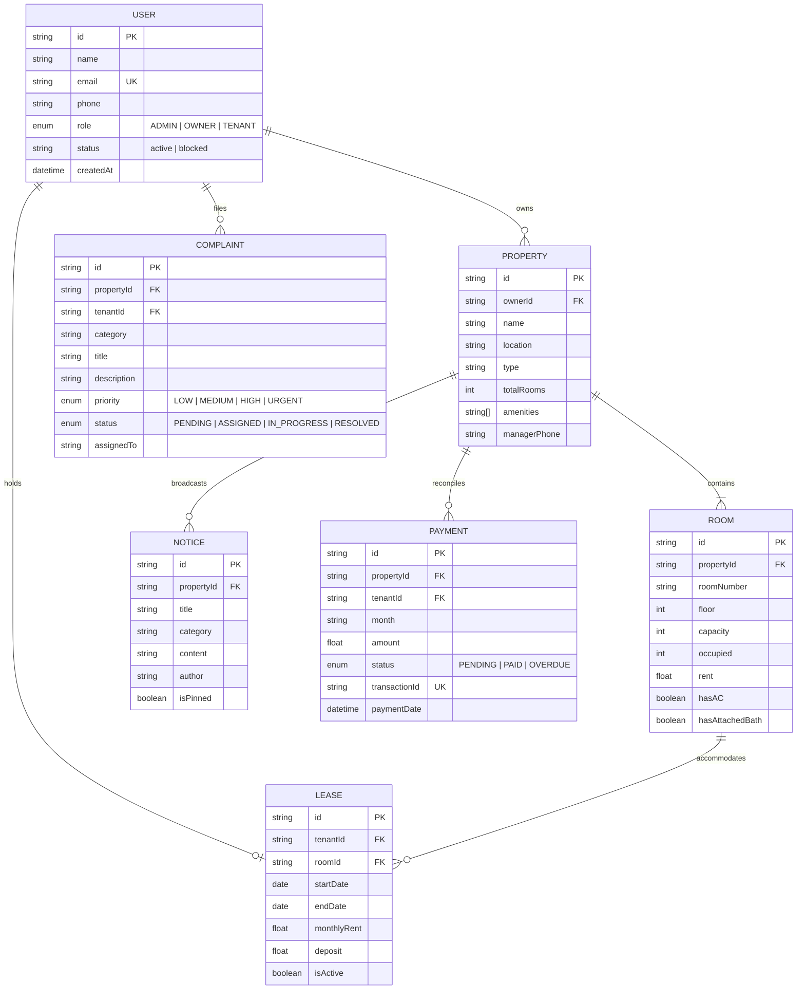

# 📦 RentEase — Week 2 Academic Deliverable
> **Database Schema, Prisma ORM Models & Express REST API Architecture**

---

## 📌 Week 2 Objectives Achieved
1. **Relational Database Design**: Designed a normalized PostgreSQL schema tailored to multi-property PG management.
2. **Prisma ORM Configuration**: Complete `schema.prisma` with Enums, composite indices, cascading rules, and relational mappings.
3. **Database Seeding (`seed.js`)**: Seed script with realistic academic demo data (Rahul Verma's Green Valley PG Sonipat & Student Homes Delhi).
4. **REST API Endpoints**:
   - `POST /api/auth/register` & `POST /api/auth/login` (JWT token based)
   - `GET /api/properties` & `POST /api/properties`
   - `GET /api/rooms` (with live occupancy calculations) & `POST /api/rooms`
   - `GET /api/tenants` & `POST /api/tenants` (lease creation)
   - `GET /api/payments` & `POST /api/payments/checkout` (mock payment simulator & tax invoice generator)
   - `GET /api/complaints` & `PATCH /api/complaints/:id/status` (4-stage lifecycle: `Pending ➔ Assigned ➔ In Progress ➔ Resolved`)
   - `GET /api/notices` & `POST /api/notices` (broadcast announcements)
5. **Role-Based Middleware**: `authenticateToken` and `authorizeRoles('OWNER', 'TENANT', 'ADMIN')`.

---

## 🗄️ Database Entity-Relationship (ER) Architecture



---

## 🚀 How to Run the Backend
```bash
# 1. Install dependencies
npm install

# 2. Run in development mode
npm run dev
# Server starts at http://localhost:5000
```

### Test Health Endpoint
```bash
curl http://localhost:5000/api/health
```

### Test Live Occupancy Summary
```bash
curl http://localhost:5000/api/rooms?propertyId=prop_1
```

### Test Mock Payment Checkout & Receipt
```bash
curl -X POST http://localhost:5000/api/payments/checkout \
  -H "Content-Type: application/json" \
  -d '{"paymentId":"pay_103_nov","paymentMethod":"UPI"}'
```
