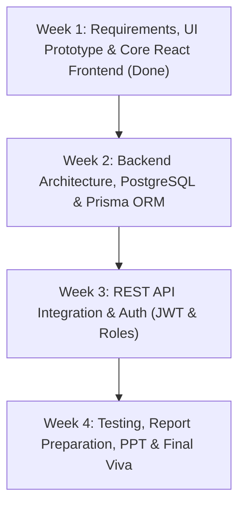

# 🗓️ RentEase — Project Schedule & Development Timeline

A 4-week structured sprint schedule designed for academic milestones, supervisor check-ins, and progressive GitHub commits.

---

## 📅 High-Level Roadmap

---

## 📆 Detailed Sprint Breakdown

### **Week 1: Frontend Architecture & Role Dashboards (Current Phase)**
- [x] Set up React 18 with Vite, Tailwind CSS, and Recharts.
- [x] Formulate initial data model (Green Valley PG Sonipat, Student Homes Delhi).
- [x] Implement **Owner Dashboard**:
  - Live occupancy calculation (Total rooms, occupied beds, vacant beds).
  - Revenue graphs (Expected vs Collected rent).
  - Modals: Add Property, Add Room, Add Tenant, Broadcast Notice.
- [x] Implement **Tenant Portal**:
  - Room & lease details view.
  - Mock Payment Gateway with simulated UPI/Card/Cash flow.
  - Printable/Downloadable digital rent receipt with invoice numbers.
  - Complaint submission and 4-stage lifecycle tracker (`Pending ➔ Assigned ➔ In Progress ➔ Resolved`).
- [x] Implement **Admin Dashboard**:
  - Platform-wide statistics, property monitoring, user block/unblock toggles.
- [x] Commit and push frontend milestone to GitHub.

---

### **Week 2: Database Schema & Backend Foundation**
- [ ] Initialize PostgreSQL database instance (Local or Neon.tech / Supabase).
- [ ] Configure `backend/prisma/schema.prisma` with relational models:
  - `User`, `Property`, `Room`, `Lease`, `Payment`, `Complaint`, `Notice`.
- [ ] Run Prisma migrations: `npx prisma migrate dev --name init`.
- [ ] Seed initial database records using `prisma/seed.js`.
- [ ] Implement Express REST API controllers:
  - `POST /api/auth/register` & `POST /api/auth/login` (with bcrypt + JWT).
  - `GET /api/properties` & `POST /api/properties`.
  - `GET /api/rooms/:propertyId` & `POST /api/rooms`.

---

### **Week 3: End-to-End API Integration & Role Authorization**
- [ ] Connect React frontend API client (`fetch` / `axios`) to Express backend endpoints.
- [ ] Implement JWT token storage and role-based route middleware (`authorize(['OWNER', 'TENANT', 'ADMIN'])`).
- [ ] Connect Rent Payment reconciliation:
  - Trigger backend transaction when tenant completes mock UPI/card payment.
  - Store payment timestamp and generate verified server invoice.
- [ ] Connect Complaints workflow:
  - Real-time status update endpoint: `PATCH /api/complaints/:id/status`.
- [ ] Mobile responsive QA pass and UI polishing.

---

### **Week 4: Final Testing, Documentation, PPT & Viva Voce**
- [ ] Prepare academic Project Report:
  - Chapter 1: Introduction & Literature Review
  - Chapter 2: System Requirement Specifications (SRS)
  - Chapter 3: System Architecture & ER Diagrams
  - Chapter 4: Implementation Details & Code Snippets
  - Chapter 5: Testing & Results
- [ ] Prepare Slide Deck (10-12 slides) focusing on:
  - Problem statement, ER Diagram, Architecture, 5-minute live demo, future scope.
- [ ] Run dry-run viva rehearsal using questions from `docs/TEACHER_IMPRESSION_AND_VIVA_PLAN.md`.
- [ ] Final project defense & code repository submission.
